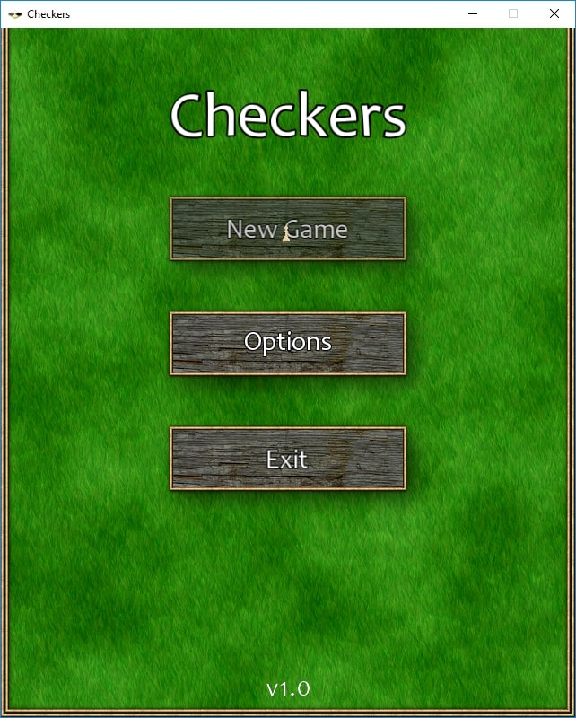
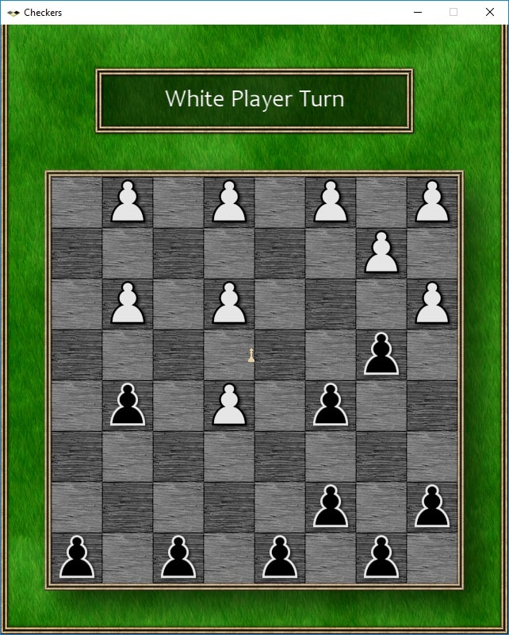
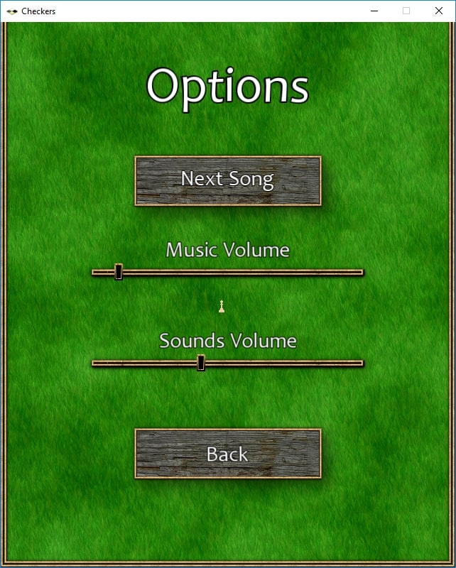

# Checkers

Classic checkers implemented in C++ using the [SFML](https://github.com/SFML/SFML)
library, with a simple yet effective AI powered by the
[minimax](https://en.wikipedia.org/wiki/Minimax) algorithm

## Title

## Game

## Options

## Requirements

You can currently build this game on Windows and Linux

To build the game, you will need:

- [Premake 5](https://premake.github.io/) or newer
- [SFML 2.4.2](https://github.com/SFML/SFML) or newer

Depending on your platform, you will also need:

- **Windows:** [Visual Studio 2017](https://visualstudio.microsoft.com/) or newer
- **Linux:** GCC 7.3.0 or newer

## Building on Windows

1. Download Premake 5.0 from the [Premake website](https://premake.github.io/download/)
and place it somewhere accessible from the command line
2. [Install the SFML library](https://www.sfml-dev.org/tutorials/2.5/compile-with-cmake.php)
on your system or [download a prebuilt package](https://www.sfml-dev.org/download/sfml/2.5.1/)
that exactly matches your compiler. Either way, you should have a directory that
contains **include**, **lib**, and **bin** subdirectories. Save the path to this
directory, you will need it later
3. Open a command line and navigate to the directory where you downloaded Checkers.
For example, if SFML is installed at `C:/SFML` and you are using
`Visual Studio 2017`, run the following command: `premake5 vs2017 --SFML_INSTALL_DIR=C:/SFML`.
Remember to adjust the path accordingly and use forward slashes
4. Open `checkers.sln` in Visual Studio and compile the Checkers project by
clicking `Build -> Build Solution`

## Building on Linux (Ubuntu)

1. Download Premake 5.0 from the [Premake website](https://premake.github.io/download/)
and place it somewhere accessible from the command line
2. Install the SFML library on your system by running this command:
`sudo apt install libsfml-dev`
3. Open a command line and navigate to the directory where you downloaded Checkers.
Run the following command: `premake5 gmake && make`. This will generate a
makefile for your system and use it to compile the project

## Credits

Making this game would not have been possible without the help of many amazing
people and websites that allow game developers to find and use fantastic,
high-quality free resources

**Websites used:**

- [OpenGameArt](https://opengameart.org/)
- [Freesound](https://freesound.org/)

**Resources used:**

- Graphics
  - [RPG GUI Construction Kit v1.0](https://opengameart.org/content/rpg-gui-construction-kit-v10)
  by [Lamoot](https://opengameart.org/users/lamoot)
  licensed under CC-BY 3.0
  - [Seamless Grass Texture II](https://opengameart.org/content/seamless-grass-texture-ii)
  by [athile](https://opengameart.org/users/athile)
  licensed under CC0 1.0 Universal
  - [Chess Pieces and Board Squares](https://opengameart.org/content/chess-pieces-and-board-squares)
  by [JohnPablok](https://opengameart.org/users/johnpablok)
  licensed under CC-BY-SA 3.0
  - [Chess Pieces](https://opengameart.org/content/chess-pieces-3)
  by [8BitGoggles](https://opengameart.org/users/8bitgoggles)
  licensed under CC-BY-SA 3.0
  - [Chess Board Icon](http://www.iconarchive.com/show/chess-icons-by-aha-soft/chess-board-icon.html)
  by [Aha-Soft](http://www.aha-soft.com/)
  licensed under [license](http://www.iconarchive.com/icons/aha-soft/chess/license.txt)
- Sounds
  - [User Interface Sound Pack](https://freesound.org/people/PaulMorek/packs/18538/)
  by [PaulMorek](https://freesound.org/people/PaulMorek/)
  licensed under CC0 1.0 Universal
  - [Game Over](https://opengameart.org/content/game-over-0)
  by [zuvizu](https://opengameart.org/users/zuvizu)
  licensed under CC0 1.0 Universal
  - [We Did It](https://freesound.org/people/eardeer/sounds/423692/)
  by [eardeer](https://freesound.org/people/eardeer/)
  licensed under CC-BY-NC 3.0
- Music
  - [Woods](https://opengameart.org/content/woods)
  by [Axton Crolley](https://opengameart.org/users/axtoncrolley)
  licensed under CC-BY 3.0
  - [Forest](https://opengameart.org/content/forest)
  by [syncopika](https://opengameart.org/users/syncopika)
  licensed under CC-BY 3.0
  - [Woodland Fantasy](https://opengameart.org/content/woodland-fantasy)
  by [Matthew Pablo](https://opengameart.org/users/matthew-pablo)
  licensed under CC-BY 3.0
  - [Decision](https://opengameart.org/content/decision)
  by [Alexandr Zhelanov](https://opengameart.org/users/alexandr-zhelanov)
  licensed under CC-BY 3.0
  - [Journey to the East Rocks](https://opengameart.org/content/journey-to-the-east-rocks)
  by [Alexandr Zhelanov](https://opengameart.org/users/alexandr-zhelanov)
  licensed under CC-BY 3.0
  - [Nature Theme Sketch](https://opengameart.org/content/nature-theme-sketch)
  by [remaxim](https://opengameart.org/users/remaxim)
  licensed under CC-BY-SA 3.0
